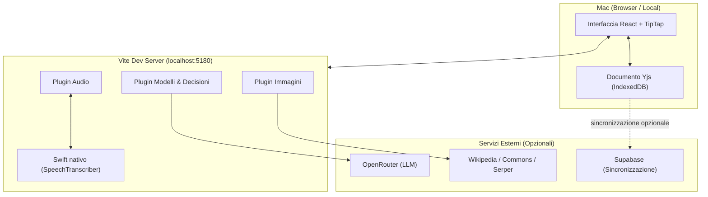

# 🐾 Berto

[](LICENSE)

[](.nvmrc)

[](#-traduzioni)

[🇬🇧 English](README.md) · [🇮🇹 Italiano](README.it.md)

Applicazione per prendere appunti a lezione. Registra e trascrive l'audio
in locale sul Mac, poi confronta la trascrizione con gli appunti e
propone le integrazioni mancanti, una per una, da accettare o rifiutare.

È un'applicazione locale: il testo è salvato in IndexedDB, l'audio in una
cartella del Mac. La sincronizzazione fra dispositivi è facoltativa e usa
un progetto Supabase configurato dall'utente.


*Una pagina di appunti aperta accanto alla barra laterale delle materie.*

---

## 📑 Indice

- [⚡ Avvio rapido](#-avvio-rapido)
- [✨ Funzionalità](#-funzionalità)
  - [✍️ Editor](#️-editor)
  - [🎙️ Registrazione e trascrizione](#️-registrazione-e-trascrizione)
  - [🧩 Integrazione degli appunti](#-integrazione-degli-appunti)
  - [⚡ Correzioni in diretta](#-correzioni-in-diretta)
  - [💬 Domande sulla lezione](#-domande-sulla-lezione)
  - [📝 Commenti](#-commenti)
  - [🖼️ Immagini](#️-immagini)
  - [📚 Ripasso e quiz](#-ripasso-e-quiz)
  - [📱 Sincronizzazione e telefono](#-sincronizzazione-e-telefono)
  - [⚙️ Personalizzazione](#️-personalizzazione)
- [⌨️ Scorciatoie da tastiera](#️-scorciatoie-da-tastiera)
- [📋 Requisiti](#-requisiti)
- [🚀 Installazione e script](#-installazione-e-script)
- [🔑 Chiavi API e modelli](#-chiavi-api-e-modelli)
- [💰 Costi](#-costi)
- [🔒 Privacy e dati](#-privacy-e-dati)
- [🏗️ Architettura](#️-architettura)
- [🛠️ Risoluzione problemi](#️-risoluzione-problemi)
- [📌 Stato del progetto](#-stato-del-progetto)
- [🌐 Traduzioni](#-traduzioni)
- [🤝 Supporto e contributi](#-supporto-e-contributi)
- [🐱 Perché Berto?](#-perché-berto)
- [📄 Licenza](#-licenza)

---

## ⚡ Avvio rapido

```bash
git clone https://github.com/TCdesign-dev/Berto.git
cd Berto
nvm use            # Node 24: Vite 8 richiede una versione superiore alla 20
npm install
cp .env.example .env.local
npm run dev        # http://localhost:5180
```

Il primo avvio compila automaticamente il componente nativo Swift (`nativo/ascolto/compila.sh`). Al primo utilizzo di **Registra** macOS richiede l'autorizzazione di accesso al microfono.

---

## ✨ Funzionalità

### ✍️ Editor
*🟢 100% locale · Nessuna connessione richiesta*

Editor a blocchi basato su TipTap, senza barra degli strumenti fissa: il
menu di formattazione compare sulla selezione (grassetto, corsivo,
sottolineato, titoli, cinque colori, evidenziatore, codice, commento,
quiz sul passaggio selezionato). Su una riga vuota `/` apre l'elenco dei
blocchi; una maniglia a sinistra della riga permette di trascinarla,
`⌘⇧↑` e `⌘⇧↓` la spostano da tastiera.

Blocchi disponibili: titoli su tre livelli, elenchi puntati e numerati
anche annidati, citazioni, codice, immagini, formule LaTeX rese con KaTeX
(`$$…$$` nel testo, `$$$…$$$` su una riga a sé). Le frecce si compongono
automaticamente: `->` diventa `→`.

### 🎙️ Registrazione e trascrizione
*🟢 100% locale · SpeechTranscriber su macOS*

`⌘R` avvia la registrazione. La trascrizione è affidata a
`SpeechTranscriber` di macOS ed è eseguita in locale: l'audio non lascia
il computer e non transita da servizi esterni.

Durante la registrazione una fascia in fondo alla pagina mostra le ultime
frasi riconosciute e il dispositivo in uso. Dopo sei secondi senza
segnale viene segnalato il silenzio — condizione frequente quando il
microfono di sistema è un dispositivo virtuale che non riceve l'audio
dell'aula. Sono disponibili pausa, scelta del microfono e salvataggio
dell'audio (circa 17 MB l'ora, disattivato per impostazione predefinita).

La lingua in cui si ascolta segue quella scelta nelle impostazioni: il
primo utilizzo di una lingua nuova comporta il download del modello di
riconoscimento da parte di macOS.

Se la pagina viene ricaricata o il Mac va in stop la registrazione
prosegue: alla riconnessione il server restituisce le frasi prodotte nel
frattempo.


*Ogni lezione conserva la propria trascrizione; con l'audio salvato si riascolta dal minuto selezionato.*

### 🧩 Integrazione degli appunti
*🤖 Richiede OpenRouter*

A lezione conclusa, **Integra negli appunti** confronta il testo scritto
con la trascrizione e inserisce le proposte nel punto in cui vanno lette.
Si scorrono con `J` e `K`, si accettano con `↵`, si rifiutano con `X`.

Comportamento delle proposte:

- **completamento invece di riscrittura.** Se la riga esiste già ma è
  incompleta, la proposta viene inserita nella riga stessa — in fondo o
  nel punto indicato dal modello. Un blocco nuovo viene creato solo
  quando l'argomento non è presente;
- **adattamento allo stile.** Prima della richiesta l'applicazione misura
  la pagina: lunghezza media delle righe, iniziale minuscola o maiuscola,
  punteggiatura finale, simboli ricorrenti, uso di grassetto e colori. Le
  istruzioni al modello includono queste misure e due righe di esempio
  prese dagli appunti;
- **tracciabilità.** Il testo proposto è sottolineato a puntini e
  mantiene il segno anche dopo l'accettazione.


*La prima proposta è un completamento: prosegue una riga esistente invece di aggiungerne una nuova.*

L'integratore propone inoltre i titoli degli argomenti mancanti, le
formule dettate a lezione (in LaTeX) e le immagini per i concetti che ne
richiedono una.

Con più lezioni sulla stessa pagina, **Integrazione completa** le elabora
in un'unica richiesta: i dati ripetuti in lezioni diverse producono una
sola proposta e le precisazioni successive prevalgono su quelle
precedenti.

### ⚡ Correzioni in diretta
*🤖 Richiede OpenRouter / Jev*

Durante la registrazione, le righe che contengono dati verificabili —
date, numeri, nomi propri, parti lasciate in sospeso — vengono
confrontate con gli ultimi novanta secondi di trascrizione. In caso di
discordanza compare un indicatore nel margine; `⌥⌘↓` apre la scheda con
la citazione e la correzione proposta, `↵` applica, `X` mantiene il testo
originale.

Il controllo è limitato a una richiesta ogni dieci secondi e ignora le
righe prive di elementi verificabili, riducendo le chiamate al modello e
le interruzioni durante la scrittura.

### 💬 Domande sulla lezione
*🤖 Richiede OpenRouter*

Un pannello permette di interrogare la pagina. Il modello riceve due
fonti: gli appunti e la trascrizione delle lezioni associate.


*Il pannello «Chiedi alla lezione» distingue tra quanto detto dal docente e quanto scritto negli appunti.*

Le risposte citano la trascrizione con il minuto di riferimento e
distinguono ciò che è stato detto a lezione da ciò che è già presente
negli appunti. Se l'informazione non è in nessuna delle due fonti, il
modello lo dichiara. Domande e risposte sono salvate nella pagina.

### 📝 Commenti
*🟢 100% locale*

`⌘⇧M` applica un commento al testo selezionato. Il passaggio commentato
resta evidenziato; il clic riapre la nota, che si può modificare o
risolvere. Un pannello elenca i commenti della pagina nell'ordine in cui
compaiono nel testo.

I commenti il cui testo di riferimento viene eliminato non vanno persi:
restano in fondo all'elenco con la citazione del passaggio originale.


*I commenti restano associati al passaggio di testo evidenziato o archiviati se il testo viene cancellato.*

### 🖼️ Immagini
*🔍 Wikipedia, Commons e Openverse senza chiavi · 🌐 Google Immagini con Serper*

Il pannello immagini cerca e inserisce illustrazioni per trascinamento;
la sintassi `!termine!` avvia la ricerca durante la scrittura. Ogni
ricerca passa da Wikipedia, che risolve il termine e fornisce l'immagine
principale dell'articolo e la traduzione inglese, usata poi su Wikimedia
Commons e Openverse — indicizzati prevalentemente in inglese. Con una
chiave Serper sono disponibili i risultati di Google Immagini.

Le immagini inserite sono salvate in locale con autore e licenza.

### 📚 Ripasso e quiz
*🤖 Richiede OpenRouter per la generazione quiz*

Ogni titolo di primo livello definisce un argomento. La scheda della
materia raccoglie gli argomenti, il riepilogo delle ultime due lezioni e
i quiz generati dagli appunti e dalla trascrizione; ogni domanda ha un
collegamento al punto corrispondente della pagina.

L'archivio riporta lo spazio occupato da pagine, trascrizioni, audio e
immagini e ne permette l'eliminazione selettiva.

### 📱 Sincronizzazione e telefono
*☁️ Facoltativa · Richiede un progetto Supabase dell'utente*

Con un progetto Supabase configurato, le pagine si sincronizzano fra Mac
e telefono. L'interfaccia per telefono è di sola lettura e usa lo stesso
schema del documento. Senza Supabase l'applicazione resta locale e le
altre funzioni sono invariate.

#### 📲 Come aprire e usare Berto sul telefono
Poiché Berto gira su `localhost` sul Mac, il telefono accede all'interfaccia in due modi:

1. **🌐 Deploy statico su hosting gratuito (Consigliato):**  
   La vista telefono è un'applicazione web statica (PWA) che comunica **esclusivamente con Supabase**, senza toccare il Mac. Puoi compilare la build (`npm run build`) e pubblicarla su un servizio gratuito come **Vercel**, **Cloudflare Pages** o **GitHub Pages**, impostando come variabili di build `VITE_SUPABASE_URL` e `VITE_SUPABASE_ANON_KEY`.  
   Sul telefono apri l'URL generato e seleziona **«Aggiungi a schermata Home»**: grazie al Service Worker, l'app funzionerà anche offline e si sincronizzerà ovunque ti trovi, anche a Mac spento.

2. **📶 Rete Wi-Fi locale (Senza pubblicare online):**  
   Se Mac e telefono sono sulla stessa rete Wi-Fi, avvia Vite con il flag host:
   ```bash
   npm run dev -- --host
   ```
   Apri sul browser del telefono l'indirizzo locale mostrato da Vite (es. `http://192.168.1.45:5180`). Il Service Worker salverà la copia nella cache locale.

### ⚙️ Personalizzazione

- **Scorciatoie** (Impostazioni › Tastiera): ogni combinazione si
  riassegna premendo i tasti; quelle già assegnate non possono essere
  sovrascritte;
- **Istruzioni dell'integratore** (Impostazioni › Integratore): il testo
  che precede appunti e trascrizione è modificabile; il formato della
  risposta resta gestito dall'applicazione;
- **Lingua** (Impostazioni › Aspetto): italiano e inglese; «come il
  sistema» segue la lingua del browser. Le lingue si aggiungono senza
  toccare il codice, vedi [Traduzioni](#-traduzioni);
- **Chiavi API**, tema, microfono, fonte delle immagini e correzioni in
  diretta sono configurabili dalle impostazioni.

---

## ⌨️ Scorciatoie da tastiera

Berto è progettato per un flusso di lavoro rapido incentrato sulla tastiera:

| Azione | Scorciatoia | Contesto |
|---|---|---|
| 🎙️ **Avvia / Ferma registrazione** | `⌘R` | Globale |
| ⚙️ **Apri Impostazioni** | `⌘,` | Globale |
| 📑 **Menu blocchi** | `/` | Editor (su riga vuota) |
| ↕️ **Sposta riga / blocco** | `⌘⇧↑` / `⌘⇧↓` | Editor |
| 💬 **Applica commento** | `⌘⇧M` | Editor (su testo selezionato) |
| 📐 **Formule matematiche KaTeX** | `$$…$$` (nel testo) · `$$$…$$$` (blocco) | Editor |
| 🔍 **Cerca immagine** | `!termine!` | Editor (durante la digitazione) |
| 🔁 **Scorri proposte di integrazione** | `J` (successiva) · `K` (precedente) | Barra revisione integrazione |
| ✅ **Accetta proposta** | `↵` | Barra revisione integrazione |
| ❌ **Rifiuta proposta** | `X` | Barra revisione integrazione |
| 💡 **Apri correzione in diretta** | `⌥⌘↓` | Indicatore correzione nel margine |
| ⚡ **Applica / Mantieni correzione** | `↵` (applica) · `X` (mantieni) | Scheda di correzione |

---

## 📋 Requisiti

- 🍏 **macOS 26** (o versione con supporto al framework `SpeechTranscriber` di sistema) per la trascrizione audio in locale; senza questo requisito, le altre funzioni restano disponibili ma non è possibile registrare l'audio;
- 🟢 **Node 24** (`nvm use` legge `.nvmrc`);
- 🛠️ **Strumenti da riga di comando di Xcode** (`xcode-select --install`), necessari una sola volta per compilare il componente nativo Swift che acquisisce l'audio;
- 🔑 Una **chiave OpenRouter** (opzionale) per le funzioni basate su modelli AI (integrazione, quiz, domande, correzioni).

---

## 🚀 Installazione e script

```bash
git clone https://github.com/TCdesign-dev/Berto.git
cd Berto
nvm use            # Node 24: Vite 8 richiede una versione superiore alla 20
npm install
cp .env.example .env.local
npm run dev        # http://localhost:5180
```

Il primo avvio esegue automaticamente `predev`, che compila il componente nativo (`nativo/ascolto/compila.sh`) nel file `build/berto-ascolto`. Al primo utilizzo di **Registra**, macOS richiede l'autorizzazione di accesso al microfono.

### 📦 Script disponibili

| Comando | Descrizione |
|---|---|
| `npm run dev` | Avvia il server di sviluppo Vite su `http://localhost:5180` (compila il componente nativo se assente) |
| `npm run check` | Esegue il controllo dei tipi TypeScript senza emettere file (`tsc -b --noEmit`) |
| `npm run build` | Controlla i tipi e compila l'applicazione per la produzione (`tsc -b && vite build`) |
| `npm run preview` | Avvia un server locale per visualizzare l'anteprima della build compilata |
| `npm run ascolto` | Ricompila manualmente il componente nativo Swift (`nativo/ascolto/compila.sh`) |
| `npm run lingue` | Rilegge il codice e aggiorna i dizionari di traduzione in `lingue/` |

---

## 🔑 Chiavi API e modelli

Due modalità alternative per configurare le chiavi:

1. 🖥️ **Dall'interfaccia (Impostazioni › Chiavi, `⌘,`)**: la chiave è salvata in `localStorage` e inviata al server locale, l'unico componente che comunica con OpenRouter. Il pulsante **Prova** ne verifica la validità;
2. 📄 **Dal file `.env.local`**, copiato da [`.env.example`](.env.example): la chiave resta fuori dal browser. Se presente, ha la precedenza.

| Chiave | Funzioni | In assenza |
|---|---|---|
| `OPENROUTER_API_KEY` | Integrazione, domande, quiz, correzioni in diretta | Scrittura, registrazione e trascrizione restano disponibili |
| `VITE_SUPABASE_URL` + `VITE_SUPABASE_ANON_KEY` | Sincronizzazione fra dispositivi (Mac e telefono) | I dati restano memorizzati sul computer |
| `SERPER_API_KEY` | Immagini da Google Immagini | Immagini da Wikipedia, Commons e Openverse |

I modelli si configurano da `.env.local` (`MODELLO_MERGE`, `MODELLO_QUIZ`, `MODELLO_VELOCE`, `MODELLO_TRIAGE`) senza modificare il codice.

> [!NOTE]
> **Configurazione del database Supabase:**  
> Se intendi attivare la sincronizzazione opzionale fra dispositivi, crea un progetto su [supabase.com](https://supabase.com), apri la sezione **SQL Editor** ed esegui il contenuto dello script [`supabase/schema.sql`](supabase/schema.sql). Lo script predispone la tabella `aggiornamenti`, gli indici per Yjs e le regole di accesso RLS (Row Level Security).

---

## 💰 Costi

L'integrazione richiede una chiamata per lezione. Le correzioni in
diretta passano da un filtro preliminare che costa una frazione di
centesimo per riga controllata e scarta le righe prive di dati
verificabili. Con i modelli predefiniti la spesa è nell'ordine di alcune
decine di centesimi al mese anche con molte ore di lezione settimanali.

La trascrizione non ha costi, essendo eseguita in locale. Le ricerche di
immagini su Wikipedia, Commons e Openverse non richiedono chiavi.

---

## 🔒 Privacy e dati

Il testo è salvato in IndexedDB, l'audio in
`~/Library/Application Support/Berto`. Escono dal computer soltanto
le pagine — se è configurata la sincronizzazione su un progetto Supabase
dell'utente — e le porzioni di appunti e trascrizione inviate al modello
quando si usano le funzioni che lo richiedono. Non è previsto alcun
account né raccolta di dati d'uso.

---

## 🏗️ Architettura

React, TypeScript e Vite. L'editor è TipTap (ProseMirror); il documento è
un `Y.Doc` di Yjs persistito in IndexedDB e, se configurato,
sincronizzato tramite Supabase. Non sono usati framework CSS né librerie
di componenti: CSS Modules e un file di token.

Il server di sviluppo Vite funge anche da backend: quattro plugin in
`server/` espongono l'acquisizione audio, il proxy verso i modelli,
l'endpoint delle decisioni e la ricerca immagini. Le chiavi API restano
lato server.



```
src/
├── editor/          editor: estensioni TipTap, menu, formule, immagini
├── documento/       Yjs e IndexedDB: quaderni, pagine, archivio
├── registrazione/   acquisizione audio, trascrizione, pannello lezioni
├── merge/           integrazione: prompt, proposte, revisione
├── correzioni/      correzioni in diretta, dal filtro alla scheda
├── domande/         domande sulla lezione
├── commenti/        commenti sul testo
├── immagini/        Wikipedia, Commons, ricerca web, immagini consigliate
├── ripasso/         argomenti, quiz, riepilogo
├── materia/         scheda della materia, esami, collegamenti
├── ricerca/         indice e ricerca nel testo
├── sync/            Supabase: autenticazione e sincronizzazione
├── tastiera/        registro delle scorciatoie
├── lingua/          dizionari, frasi e formati della lingua scelta
├── telefono/        interfaccia di sola lettura
├── layout/          struttura, barre, pannelli, impostazioni
├── lib/             modelli, decisioni, utilità di testo, icone
└── stili/           token, colori, animazioni, stile del contenuto

server/              plugin Vite: audio, modelli, decisioni, immagini
nativo/ascolto/      componente Swift per acquisizione e trascrizione
lingue/              un file JSON per lingua: frase italiana → traduzione
strumenti/           lingue.mjs: estrae le frasi e aggiorna i dizionari
supabase/schema.sql  tabella, indici e politiche di accesso
docs/                quaderno di bordo e immagini
```

---

## 🛠️ Risoluzione problemi

- 🎙️ **Mancata trascrizione o rilevamento continuo di silenzio:**  
  Assicurati che nelle impostazioni di registrazione sia selezionato il microfono corretto. Se macOS non rileva la voce, verifica in *Impostazioni di Sistema › Privacy e sicurezza › Microfono* che il terminale o l'app abbiano l'autorizzazione ad acquisire l'audio.
- ⚙️ **Fallimento nella compilazione del modulo nativo Swift:**  
  Se `npm run dev` segnala un errore durante l'esecuzione di `compila.sh`, verifica che gli strumenti da riga di comando di Xcode siano presenti eseguendo `xcode-select --install`. Puoi ripetere la compilazione manuale in qualsiasi momento con `npm run ascolto`.
- 🌐 **Primo avvio con una lingua nuova:**  
  Quando selezioni una lingua per la prima volta, macOS scarica in background il modello linguistico locale di `SpeechTranscriber`. La prima trascrizione potrebbe richiedere qualche istante prima di iniziare a produrre testo.
- ☁️ **Errori di sincronizzazione con Supabase:**  
  Verifica di aver incollato ed eseguito lo script [`supabase/schema.sql`](supabase/schema.sql) nell'editor SQL del tuo progetto Supabase e che le credenziali in `.env.local` o nelle Impostazioni non contengano spazi accidentali.

---

## 📌 Stato del progetto

Sviluppo attivo, in uso quotidiano da settembre 2026. Le funzioni
descritte sono complete e provate su lezioni reali; le istruzioni ai
modelli sono la parte soggetta a modifiche più frequenti.

Non sono previsti pacchetti di installazione né servizi ospitati:
l'applicazione si esegue localmente a partire dal codice sorgente.

---

## 🌐 Traduzioni

L'interfaccia è disponibile in italiano e in inglese. Ogni lingua è un
file JSON in `lingue/`: la chiave è la frase italiana, il valore la
traduzione. Le frasi senza traduzione compaiono in italiano, quindi una
lingua è utilizzabile anche incompleta.

```bash
# Crea un nuovo file lingue/<codice>.json pronto da compilare
npm run lingue -- --nuova es

# Rilegge il codice e sincronizza tutti i file di lingua esistenti
npm run lingue
```

Per la guida completa sui campi di configurazione della lingua (`_`), la gestione dei plurali e le linee guida, consulta [CONTRIBUTING.md](CONTRIBUTING.md#traduzioni).

---

## 🤝 Supporto e contributi

Segnalazioni e domande:
[issue](https://github.com/TCdesign-dev/Berto/issues). Per un
problema di avvio sono utili la versione di macOS, quella di Node e
l'output del terminale in cui gira `npm run dev`.

Le pull request sono benvenute: [CONTRIBUTING.md](CONTRIBUTING.md). Per
modifiche sostanziali conviene aprire prima una issue: alcune scelte
strutturali — assenza di librerie di componenti, documento come unica
fonte, chiavi API fuori dal browser — condizionano l'implementazione.

---

## 🐱 Perché Berto?

Il progetto è dedicato alla memoria di **Berto**, il mio gatto, che con la sua presenza silenziosa mi ha fatto compagnia durante innumerevoli ore di lezioni, studio e sessioni di programmazione.

---

## 📄 Licenza

Distribuito sotto licenza [MIT](LICENSE).
