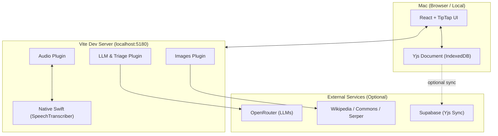

# Berto

[](LICENSE)

[](.nvmrc)

[](#translations)

[🇬🇧 English](README.md) · [🇮🇹 Italiano](README.it.md)

A lecture note-taking application designed for students. Records and transcribes audio locally on macOS, then compares the live transcript with your handwritten notes and suggests missing details — line by line, for you to accept or decline.

An offline-first, local application: text documents live in IndexedDB, audio is kept on your Mac. Cross-device synchronization is optional and backed by a user-configured Supabase project.


*A note-taking workspace open beside the course sidebar.*

---

## Table of Contents

- [Quick Start](#quick-start)
- [Features](#features)
- [Keyboard Shortcuts](#keyboard-shortcuts)
- [Requirements](#requirements)
- [Installation and Scripts](#installation)
- [API Keys and Models](#api-keys)
- [Sync and Mobile Access](#sync-and-mobile-access)
- [Costs](#costs)
- [Privacy and Data](#privacy-and-data)
- [Architecture](#architecture)
- [Troubleshooting](#troubleshooting)
- [Project Status](#project-status)
- [Translations](#translations)
- [Contributing](#contributing)
- [Why Berto?](#why-berto)
- [License](#license)

---

## Quick Start

```bash
git clone https://github.com/TCdesign-dev/Berto.git
cd Berto
nvm use            # Node 24: Vite 8 requires Node > 20
npm install
cp .env.example .env.local
npm run dev        # http://localhost:5180
```

The first run automatically compiles the native Swift audio component (`nativo/ascolto/compila.sh`). On your first click of **Record**, macOS prompts for microphone access permission.

---

## Features

### Editor
*100% Local · No internet connection required*

A block-based editor built on TipTap, free of cluttered fixed toolbars: the formatting menu floats directly on active selection (bold, italic, underline, headings, five colors, highlighter, code, comments, quiz generator on selected excerpts). On an empty line, pressing `/` summons the block picker; a grab handle on the left enables drag-and-drop reordering, while `⌘⇧↑` and `⌘⇧↓` move blocks directly from the keyboard.

Supported blocks: three levels of headings, nested bulleted and numbered lists, quotes, code snippets, local and web images, and LaTeX formulas rendered with KaTeX (`$$…$$` inline, `$$$…$$$` block). Arrows compose automatically: typing `->` turns into `→`.

### Recording and Transcription
*100% Local · Powered by macOS SpeechTranscriber*

`⌘R` triggers live recording. Transcription is performed by Apple's built-in `SpeechTranscriber` framework directly on macOS: audio never leaves your machine and avoids third-party speech APIs entirely.

During recording, a status bar along the bottom displays recognized phrases and active audio input. If silence persists for longer than six seconds, a visual prompt warns you — a common scenario when a virtual loopback device is active instead of the classroom microphone. Includes pause controls, device switching, and optional raw audio archiving (~17 MB/hour, disabled by default).

The listening language mirrors your settings choice: using a new language for the first time triggers an on-demand download of Apple's local recognition model.

If you refresh the browser or the Mac enters sleep mode, recording continues uninterrupted in the background: upon reconnecting, the server replays any queued sentences.


*Each lecture retains its own transcript; with saved audio you can replay starting from any chosen timestamp.*

### Note Integration (Smart Merge)
*Requires OpenRouter*

Once a lecture wraps up, **Integrate into notes** compares your written notes against the transcript and places targeted insertion proposals exactly where they belong in the document. Cycle proposals with `J` and `K`, accept with `↵`, or dismiss with `X`.

Smart proposal mechanics:

- **Completion over rewrite.** If an existing note line is incomplete, the proposal finishes the sentence — inline or at the relevant position indicated by the model. A brand-new block is introduced only when an entire topic was omitted;
- **Style matching.** Before issuing prompts, Berto analyzes your page: median line length, capitalization patterns, punctuation, recurring symbols, bold tags, and color choices. Instructions fed to the model include these measurements along with two real sample excerpts;
- **Full traceability.** Proposed additions are marked with a dotted underline and retain their provenance even after acceptance.


*The first proposal is a completion: it continues an existing sentence instead of appending a new block.*

The integrator also detects missing section titles, dictation of mathematical formulas (in LaTeX), and suggests illustrative diagrams for visual concepts.

When multiple lectures are linked to the same document, **Full Integration** aggregates them in a single pass: deduplicating overlapping material and prioritizing later clarifications over earlier statements.

### Live Corrections
*Requires OpenRouter / Jev*

While recording, lines containing verifiable factual assertions — dates, figures, proper names, or trailing thoughts — are verified against the preceding 90 seconds of transcript. When a mismatch is identified, an indicator appears in the left margin; pressing `⌥⌘↓` reveals the exact spoken citation and proposed adjustment. Press `↵` to adopt or `X` to keep your original wording.

Checks are throttled to at most one request every 10 seconds and bypass lines without factual claims, saving tokens and preserving your focus while typing.

### Ask the Lecture
*Requires OpenRouter*

A dedicated query drawer allows you to interrogate the page. The LLM receives two grounded sources: your written notes and the transcript of all associated lectures.


*The query panel cites timestamps and distinguishes what was spoken by the lecturer from what was already noted.*

Answers quote the transcript with exact minute markers and clearly delineate what was stated in class versus what was already documented. If an answer cannot be grounded in either source, the model explicitly acknowledges it. All queries and answers persist alongside the page.

### Comments
*100% Local*

`⌘⇧M` attaches an inline comment to selected text. Commented passages remain subtly highlighted; clicking opens the note for editing or resolving. A sidebar lists all active comments ordered by document appearance.

If commented text is later deleted, the note is never lost: it moves to the bottom of the drawer preserving a citation of the original deleted passage.


*Comments stay anchored to highlighted passages or archive gracefully if parent text is removed.*

### Images
*Wikipedia, Commons, and Openverse without keys · Google Images via Serper*

A media panel lets you discover and drag-and-drop illustrations; typing `!query!` triggers immediate image discovery right from the editor. Queries route through Wikipedia to resolve canonical entities, retrieving the article lead image and English translations used to search Wikimedia Commons and Openverse. Providing an optional Serper API key unlocks Google Images search results.

Inserted illustrations are cached locally with author and licensing attribution.

### Review and Quizzes
*Requires OpenRouter for quiz generation*

Every top-level heading designates a study topic. The subject dashboard gathers topics, summaries of the last two lectures, and flashcards/quizzes generated from notes and transcripts. Every question links directly back to the relevant source paragraph.

The storage inspector reports disk usage for documents, transcripts, audio, and media, enabling selective cleanup.

---

## Sync and Mobile Access
*Optional · Requires user-provisioned Supabase project*

Configuring Supabase enables bi-directional synchronization between your Mac and smartphone. The mobile view is read-only and shares the exact same ProseMirror document schema. Without Supabase, Berto operates purely offline as a local application.

### How to Access Berto on Your Phone

Because Berto runs on `localhost` on macOS, your smartphone can open the reader through two straightforward approaches:

1. **Free Static Hosting (Recommended):**  
   The mobile view is a static Progressive Web App (PWA) that talks **directly to Supabase** in the cloud without needing your Mac online. Build the app (`npm run build`) and deploy the output to free hosting providers such as **Vercel**, **Cloudflare Pages**, or **GitHub Pages**, providing `VITE_SUPABASE_URL` and `VITE_SUPABASE_ANON_KEY` as environment variables.  
   On your phone, navigate to your deployed URL and tap **«Add to Home Screen»**: the Service Worker caches the app shell, allowing you to review your notes anytime, anywhere — even when your Mac is sleeping at home.

2. **Local Wi-Fi Network (Zero cloud deployment):**  
   When your phone and Mac share the same Wi-Fi network, launch Vite with network exposure:
   ```bash
   npm run dev -- --host
   ```
   Open the local IP displayed in your terminal on your phone browser (e.g. `http://192.168.1.45:5180`). The Service Worker will automatically cache the reader shell for offline review.

---

## Keyboard Shortcuts

Berto is optimized for a fast, keyboard-first workflow:

| Action | Shortcut | Context |
|---|---|---|
| **Start / Stop Recording** | `⌘R` | Global |
| **Open Settings** | `⌘,` | Global |
| **Block Slash Menu** | `/` | Editor (empty line) |
| **Move Line / Block Up & Down** | `⌘⇧↑` / `⌘⇧↓` | Editor |
| **Attach Comment** | `⌘⇧M` | Editor (selected text) |
| **KaTeX Math Formulas** | `$$…$$` (inline) · `$$$…$$$` (block) | Editor |
| **Search Image** | `!query!` | Editor (inline typing) |
| **Cycle Merge Proposals** | `J` (next) · `K` (previous) | Integration review bar |
| **Accept Proposal** | `↵` | Integration review bar |
| **Reject Proposal** | `X` | Integration review bar |
| **Inspect Live Correction** | `⌥⌘↓` | Margin indicator |
| **Apply / Keep Live Correction** | `↵` (apply) · `X` (keep) | Correction sheet |

---

## Requirements

- **macOS 26** (or macOS release with Apple `SpeechTranscriber` support) for local on-device speech transcription; without this, writing, organizing, and review features remain fully operational, but live recording is disabled;
- **Node 24** (`nvm use` reads `.nvmrc`);
- **Xcode Command Line Tools** (`xcode-select --install`), required once to build the native Swift audio capture executable;
- An **OpenRouter API Key** (optional) for AI features (integration merge, quiz generation, live corrections, lecture Q&A).

---

## Installation

```bash
git clone https://github.com/TCdesign-dev/Berto.git
cd Berto
nvm use            # Node 24: Vite 8 requires Node > 20
npm install
cp .env.example .env.local
npm run dev        # http://localhost:5180
```

Launching `npm run dev` triggers the `predev` lifecycle hook, which compiles the native Swift module (`nativo/ascolto/compila.sh`) into `build/berto-ascolto` if not already present.

### Available Scripts

| Command | Purpose |
|---|---|
| `npm run dev` | Starts the Vite dev server at `http://localhost:5180` (builds native binary if missing) |
| `npm run check` | Runs TypeScript type checking without emitting files (`tsc -b --noEmit`) |
| `npm run build` | Validates types and compiles production frontend bundle (`tsc -b && vite build`) |
| `npm run preview` | Serves a local preview of the production build |
| `npm run ascolto` | Manually recompiles the native Swift audio binary (`nativo/ascolto/compila.sh`) |
| `npm run lingue` | Scans source code and synchronizes translation dictionaries in `lingue/` |

---

## API Keys

Credentials can be configured via two alternate pathways:

1. **From the UI (Settings › Keys, `⌘,`)**: keys are stored in `localStorage` and dispatched only to the local Vite backend proxy. The **Test** button validates credentials immediately;
2. **Via `.env.local`**, cloned from [`.env.example`](.env.example): keys remain strictly off browser memory. If defined, `.env.local` takes precedence.

| Variable | Enabled Features | Fallback Behavior |
|---|---|---|
| `OPENROUTER_API_KEY` | Merge integration, Q&A, quizzes, live corrections | Text editing, recording, and local transcription remain available |
| `VITE_SUPABASE_URL` + `VITE_SUPABASE_ANON_KEY` | Real-time cross-device sync (Mac and mobile) | All notes remain exclusively on your local machine |
| `SERPER_API_KEY` | Google Images search | Creative Commons media from Wikipedia, Wikimedia Commons, and Openverse |

AI model identifiers can be switched from `.env.local` (`MODELLO_MERGE`, `MODELLO_QUIZ`, `MODELLO_VELOCE`, `MODELLO_TRIAGE`) without altering application code.

> [!NOTE]
> **Supabase Database Provisioning:**  
> If enabling cross-device sync, create a free project on [supabase.com](https://supabase.com), open the **SQL Editor**, and execute the script in [`supabase/schema.sql`](supabase/schema.sql). This sets up the `aggiornamenti` delta table, Yjs indexes, and Row Level Security (RLS) policies.

---

## Costs

Merge integrations issue a single API call per lecture. Live factual corrections pass through a low-latency triage filter costing fractions of a cent per evaluated statement. Under default models, typical students spend under a few dozen cents per month even across heavy weekly lecture schedules.

Audio transcription incurs zero cost, running entirely on local Apple Silicon hardware. Image lookups via Wikipedia and Wikimedia Commons require no keys.

---

## Privacy and Data

Documents are persisted in IndexedDB; audio recordings are saved to `~/Library/Application Support/Berto`. Data leaves your machine solely when optional Supabase sync is enabled or when note snippets are dispatched to user-configured LLM providers for merge and Q&A. There are zero tracking scripts, telemetry, or user accounts.

---

## Architecture

React, TypeScript, and Vite. The editor core is TipTap (ProseMirror); documents are modeled as Yjs `Y.Doc` instances persisted to IndexedDB and synchronized via Supabase when configured. No monolithic CSS libraries: crafted with scoped CSS Modules and a design token sheet.

Vite acts as a dual development server and local backend: four custom plugins in `server/` expose Swift audio capture, LLM proxying, decision triage, and image discovery. Secrets never reach the client.



```
src/
├── editor/          TipTap extensions, menus, formulas, image integration
├── documento/       Yjs and IndexedDB: notebooks, documents, archives
├── registrazione/   Audio capture, transcription, lecture dashboard
├── merge/           Smart integration: prompts, suggestions, review UI
├── correzioni/      Live corrections, from triage filter to sheet
├── domande/         Lecture Q&A drawer
├── commenti/        Inline text annotations
├── immagini/        Media search, Commons, web results, recommendations
├── ripasso/         Topic explorer, quizzes, subject review
├── materia/         Course overview, exam schedules, backlinks
├── ricerca/         Full-text search and indexing
├── sync/            Supabase: authentication and replication
├── tastiera/        Keyboard shortcuts registry
├── lingua/          I18n dictionaries, formatters, and locales
├── telefono/        Read-only mobile reader PWA
├── layout/          Chrome, drawers, sidebars, settings
├── lib/             Models, decision client, string helpers, icons
└── stili/           Design tokens, color palettes, animations

server/              Vite plugins: audio, llm, triage, images
nativo/ascolto/      Swift binary for audio capture and SpeechTranscriber
lingue/              Language JSON files: phrase → translation
strumenti/           lingue.mjs: string extraction and dictionary sync
supabase/schema.sql  Table schema, indexes, and RLS security policies
docs/                Architecture logbook and documentation assets
```

---

## Troubleshooting

- **No transcription or perpetual silence detected:**  
  Verify that the appropriate microphone input is selected in the lecture drawer. If macOS fails to capture voice, ensure your terminal has microphone permissions under *System Settings › Privacy & Security › Microphone*.
- **Native Swift compilation error:**  
  If `npm run dev` reports an error compiling `nativo/ascolto/compila.sh`, ensure Xcode CLI Tools are installed by executing `xcode-select --install`. You can force re-compilation manually at any time with `npm run ascolto`.
- **First run with a new language:**  
  When selecting a new speech recognition language, macOS downloads speech assets in the background. The initial transcription may pause briefly before streaming text.
- **Supabase synchronization errors:**  
  Ensure you executed [`supabase/schema.sql`](supabase/schema.sql) in your Supabase SQL Editor and confirm that API keys in `.env.local` or Settings do not contain accidental whitespaces.

---

## Project Status

Active development, in daily academic use since September 2026. Described features are tested on real university lectures. Model instructions undergo continuous optimization.

No pre-packaged binaries or hosted web services are planned: Berto is executed locally from source.

---

## Translations

The interface supports English and Italian out of the box. Additional languages require only a single JSON file in `lingue/`: keys represent source strings, and missing translations fall back cleanly to default text.

```bash
# Generate a new template lingue/es.json ready for translation
npm run lingue -- --nuova es

# Scan code and synchronize all dictionary files
npm run lingue
```

For full details on locale metadata, plural forms, and formatting tags, see [CONTRIBUTING.md](CONTRIBUTING.md#translations).

---

## Contributing

Questions and bug reports: [issue tracker](https://github.com/TCdesign-dev/Berto/issues). When reporting start-up issues, please provide your macOS version, Node version, and terminal logs.

Pull requests are welcome: see [CONTRIBUTING.md](CONTRIBUTING.md).

---

## Why Berto?

This project is named in loving memory of **Berto**, my cat, who faithfully kept me company through countless hours of study, lecture listening, and coding sessions.

---

## License

Distributed under the [MIT License](LICENSE).
